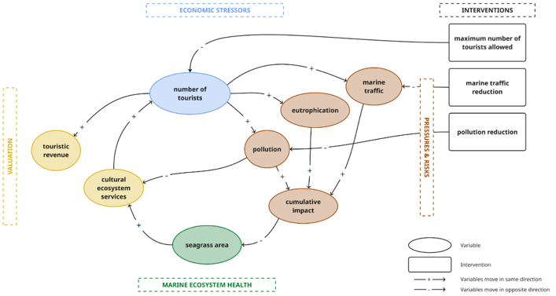

# MARBIOSE Spatial Scenarios Dashboard

## Overview

The MARBIOSE (European MARine BIOdiversity and ecosystem goods & Services) Dashboard is a decision-support platform developed within the DiverSea project to explore how marine biodiversity, ecosystem services, and human activities interact under different policy scenarios. In addition to time-series outputs from System Dynamics (SD) models, the dashboard includes a **Spatial Scenarios** module that visualizes where ecological and socio-economic impacts occur across space and time.
The current implementation focuses on the Santorini (Hellenic Volcanic Arc) case study, where interactions between tourism and seagrass ecosystems are simulated. The dashboard allows users to compare multiple management scenarios and visualize changes in:

* Seagrass distribution and degradation
* Tourism pressure
* Marine protected area (MPA) interventions
* Ecosystem service indicators

The spatial scenarios complement the temporal SD model outputs by answering not only **how much change occurs**, but also **where that change occurs**.

---

## Dashboard Access

The MARBIOSE dashboard is available at:

https://diversea.marvin.vito.be/

The dashboard allows users to explore temporal and spatial biodiversity scenarios, compare management interventions, and visualize ecosystem responses through interactive maps and indicators.

---

## Spatial Modelling Workflow

The workflow combines a System Dynamics model implemented in Vensim and executed through PySD with geospatial datasets describing:

* Seagrass distribution
* Marine traffic density
* Tourism hotspots
* Marine protected areas (MPAs)

    
     
    <strong> Structural overview of the “Touristic island without fisheries” model within the model buildup tab of the MARBIOSE dashboard. </strong>

The SD model simulates ecosystem dynamics over time, while the spatial component translates those results into maps representing future spatial patterns of seagrass presence and tourism pressure.

The implementation follows a **unidirectional coupling approach**, where SD model outputs are spatially allocated, but spatial changes do not feed back into the SD model.

---

## Python Implementation

The spatial scenario workflow is implemented in the script
`MARBIOSE_spatial_scenarios.py`.

The script integrates System Dynamics outputs from a PySD-converted
Vensim model with spatial datasets describing seagrass distribution,
marine traffic density, tourism hotspots, and marine protected areas.

Main functions of the script include:

- Loading and preprocessing spatial datasets
- Dividing seagrass meadows into 5 × 5 km spatial units
- Calculating local marine traffic pressure
- Executing the System Dynamics model for each spatial unit
- Simulating spatial seagrass degradation through stochastic erosion
- Performing 100 Monte Carlo simulations
- Generating tourism pressure maps
- Exporting raster layers for visualization in the MARBIOSE dashboard

---

## How Seagrass Spatial Scenarios Are Calculated

### 1. Seagrass Polygon Preparation

The workflow begins with observed seagrass polygons representing the 2014 baseline distribution. Small patches (<1000 m²) are removed to avoid insignificant fragments. The remaining meadows are subdivided into 5 × 5 km spatial units.

The Python implementation performs this subdivision using a coarse 5 km grid and intersects it with the original seagrass polygons.

### 2. Marine Traffic Assignment

For every seagrass unit, average vessel density is extracted from a marine traffic raster. These values are converted to relative marine traffic density and used as local pressure inputs to the SD model.

### 3. System Dynamics Simulation

Each spatial unit is linked to an independent SD model realization. The model estimates future seagrass area for selected reporting years (2014, 2020, 2030, 2040, and 2050) as a function of tourism pressure, marine traffic, pollution, and ecological feedbacks.

### 4. Raster Conversion

The resulting polygons are converted into a fine-resolution 30 m raster grid. For each year, the SD model output is translated into a target number of seagrass cells that should remain present.

### 5. Spatial Erosion Algorithm

To simulate seagrass decline spatially, cells are removed until the target area is reached. The erosion procedure follows ecological assumptions regarding Posidonia oceanica degradation:

1. Isolated cells are removed first.
2. Weakly connected edge cells are removed next.
3. If necessary, cells are removed from patch boundaries.
4. Core areas are preserved as long as possible.

This reproduces fragmentation and edge erosion patterns observed in real seagrass meadows.
Importantly, neighbourhood calculations are performed on the original parent meadow rather than on isolated grid cells, preventing artificial edge effects introduced by the 5 km subdivision.

### 6. Monte Carlo Simulation

## Because cell removal contains stochastic elements, the erosion process is repeated 100 times using different random seeds. The resulting maps are aggregated into probability surfaces representing the expected likelihood of seagrass presence.

## How Tourism Pressure Maps Are Calculated

Tourism is represented spatially using accommodation and tourism hotspot locations derived from OpenStreetMap.
The workflow is:

1. Create a raster representation of land areas.
2. Rasterize tourism hotspots.
3. Compute the distance from every land cell to the nearest hotspot.
4. Generate a tourism probability surface using an exponential distance-decay function.
5. Obtain the tourism fraction from the SD model.
6. Activate a proportional number of raster cells according to the probability surface.

## Cells close to tourism hotspots have a higher probability of being selected, resulting in realistic tourism concentration patterns that expand as visitor numbers increase.

## Implemented Scenarios

The model currently includes four scenarios:

| Scenario                             | Description                                                                            |
| ------------------------------------ | -------------------------------------------------------------------------------------- |
| Base                                 | Default Santorini configuration                                                        |
| MPA – No Traffic                     | Marine traffic removed inside protected seagrass areas                                 |
| MPA – No Traffic + Reduced Pollution | Marine traffic removed and pollution per tourist reduced to 50% inside protected areas |
| Seagrass Weight = 1                  | Strong feedback between seagrass condition and tourism development                     |

These scenarios correspond directly to the Python implementation.

## For MPA scenarios, protected seagrass units are separated into protected and unprotected components. Modified parameters are applied only to protected sections while unaffected areas retain baseline settings.

## Outputs

The workflow produces:

* Mean seagrass presence probability maps
* Seagrass uncertainty maps (standard deviation)
* Tourism pressure maps
* Time slices for 2014, 2020, 2030, 2040, and 2050
* Scenario comparison layers

Raster outputs are exported as Cloud Optimized GeoTIFFs (COGs) for efficient visualization within the MARBIOSE dashboard, while protected areas are stored as vector tiles (MBTiles).
